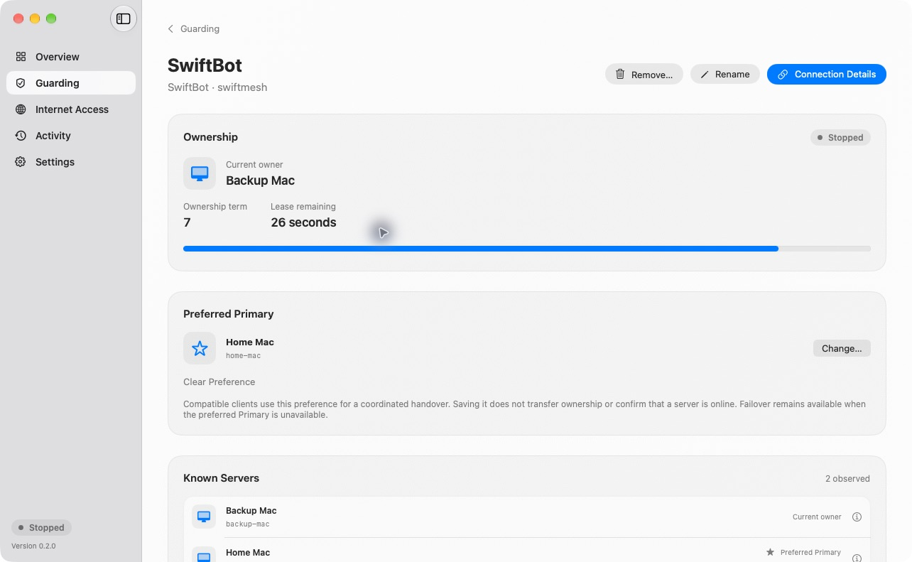

# Preferred Primary

Ruru stores an operator-selected **Preferred Primary** for each guarded service.
This is advisory intent for compatible clients, separate from the **Current
Owner** recorded by the lease authority. Saving or clearing a preference does
not release/revoke ownership, change a term, restart the listener, or reserve
the next grant. Older clients keep their existing behavior.

## Operator setup

Open **Guarding → service → Preferred Primary → Choose Primary**. Choose a
previously observed server, or **Enter Node ID** for a standby that has not held
ownership yet. Use the server's stable node ID, not its display name, hostname
or address. Save Preference persists it before publishing it to the live
listener. **Clear Preference** restores normal client selection.

The selected node ID remains visible even if its old activity is pruned. A
preferred server is not necessarily online or eligible to own the workload.
Known Servers still contains only observed ownership participants. Nicknames
are cosmetic and never change the preference's identity.

Failover remains possible when the preferred server is unavailable. Returning
ownership to it requires the guarded app's coordinated handover implementation.
Ruru does not probe participants or contact a bot to force promotion. SwiftBot
support for this API is a separate integration task.



## Read-only client API, version 1

Send an authenticated request to the same app-wide endpoint as the lease routes:

```http
POST /v1/service/policy
Authorization: Bearer <this service's token>
Content-Type: application/json

{"clusterID":"swiftmesh"}
```

Success:

```json
{
  "version": 1,
  "clusterID": "swiftmesh",
  "preferredPrimaryNodeID": "server-a",
  "preferenceRevision": 1
}
```

No preference, including after clearing:

```json
{
  "version": 1,
  "clusterID": "swiftmesh",
  "preferredPrimaryNodeID": null,
  "preferenceRevision": 2
}
```

- `preferredPrimaryNodeID` is a stable, case-sensitive node ID or explicit null.
  Valid selected IDs are 1–128 UTF-8 bytes, have no control characters and have
  no leading/trailing whitespace. A display name never substitutes for this ID.
- `preferenceRevision` is a nonnegative signed 64-bit integer. It begins at zero
  with no preference, increments on each actual selection/clear, survives
  relaunch and does not increment on an unchanged save. It is not a lease term.
- Missing/incorrect credentials return 401. Cross-service or unknown cluster
  requests return 403. Invalid JSON/body returns 400. Unsupported paths/methods
  return 404. Responses use `Cache-Control: no-store`.
- This endpoint is read-only. It never allocates a lease, extends permission,
  writes audit events or changes database state. A 200 policy response during
  restart quarantine is valid; lease acquisition/renewal still returns 503.
- Public `/health` never exposes preferences, node IDs, services or credentials.
- Removing a service revokes its policy access too. Re-adding one creates a new
  service credential and a fresh preference revision sequence. Clients must
  clear their policy cache when endpoint, cluster ID or credential changes.
- There is no remote preference-writing endpoint. Only the operator's local
  console changes this intent.

## SwiftBot integration requirements

Poll approximately every five seconds while witness-backed SwiftMesh is active,
using a bounded request timeout. Validate version, cluster, ID and revision;
ignore out-of-order responses and cancel old polls after configuration changes.
An unavailable, malformed or unsupported policy must not initiate a new handover
from stale intent. An older witness returning 404 keeps legacy behavior.

An updated client can use a current policy to prefer an eligible, paired node
and request coordinated handback when that node is ready. The existing owner
must freeze/drain output and synchronize state before releasing its lease. The
target must acquire a valid new lease before enabling output. If a release is
uncertain, wait for permission expiry; never infer successful transfer from a
network timeout, policy selection or peer unreachability.

Keep failover available if the preferred node is offline, unknown, unpaired or
otherwise ineligible. Workers must not be promoted just because their ID was
selected. Never bypass `DiscordService.outputAllowed`, monotonic lease expiry,
term fencing, the existing handover protocol or restart quarantine. Policies
do not grant credentials or peer membership. When Ruru is configured but
unreachable, never fall back to an independent election that bypasses its leases.

For implementation in the SwiftBot repository, use the
[Claude prompt](SWIFTBOT_PRIMARY_PROMPT.md).

## Validation limits

Ruru's implementation and tests cover persistent intent, scoped reads, live
changes, retained leases/terms and quarantine. Automatic Primary selection and
coordinated return are not deployment-validated until SwiftBot implements and
tests this client contract with paired nodes.
