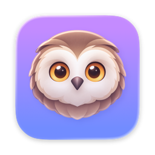
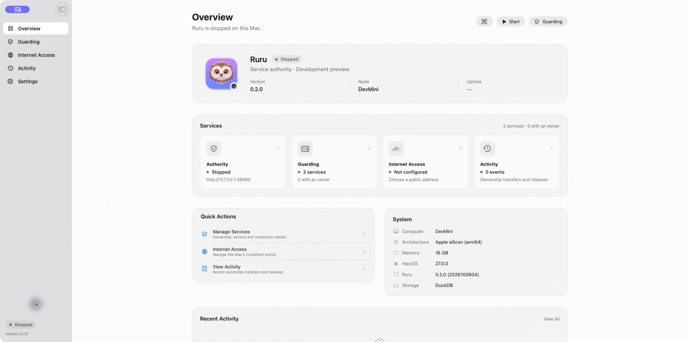

  

<h1 align="center">Ruru</h1>

<strong>Complicated service coordination, made easy to manage.</strong>

  A native macOS app for managing which server has permission to act. Built for SwiftBot, with room for other apps.

  <a href="https://github.com/johnwatso/ruru/releases"><strong>GitHub Releases</strong></a> ·
  <a href="Documentation/SETUP.md">Getting Started</a> ·
  <a href="Documentation/README.md">Documentation</a>

  
  
  
  

> [!NOTE]
> **Ruru is in very early development.** I'm designing it around the needs of SwiftBot, so features, setup, and behaviour are highly likely to change.

<!-- Both Overview images use isolated screenshot fixtures, not a live authority. -->

  <picture>
    <source media="(prefers-color-scheme: dark)" srcset="Documentation/Images/overview-dark.png">
    <source media="(prefers-color-scheme: light)" srcset="Documentation/Images/overview.png">
    
  </picture>

## Highlights

- See your services, their current owners, and connection status in one place
- Manage separate SwiftBot groups and other compatible apps
- Inspect resource locations reported by servers in an opt-in catalogue
- Choose a Preferred Primary for clients that support it
- Search ownership history using readable server names
- Set up Internet Access through built-in Cloudflare support
- Keep the service running in the menu bar when the window closes

## Installation

Ruru requires **macOS 15.0 or later** and an independent Mac that all participating servers can reach. It runs separately from the guarded apps and does not process their workloads.

Public release assets are not published yet. For now, [build Ruru from source](Documentation/DEVELOPMENT.md), move `Ruru.app` into Applications, and follow the [setup guide](Documentation/SETUP.md) to pair SwiftBot or [integrate another app](Documentation/INTEGRATIONS.md). Published builds will be available from [GitHub Releases](https://github.com/johnwatso/ruru/releases).

## Why Ruru?

Ruru exists to make a complicated feature easy to manage. Keeping multiple servers coordinated takes care; setting them up and seeing which one is allowed to act should be straightforward.

It runs on a separate Mac and gives one server at a time permission to act for each service. If a server cannot reach Ruru, it stops acting when that permission expires. The app brings setup, status, and ownership history together in one place.

The name comes from the ruru, New Zealand's native owl. The app is a small guardian: it watches ownership and keeps the decision in one place.

## Acknowledgements

Ruru is a sister app to SwiftBot and uses its SwiftMesh lease protocol and native console design. The README follows the presentation used by [SwiftMiner](https://github.com/johnwatso/SwiftMiner).

[DuckDB Swift](https://github.com/duckdb/duckdb-swift) provides the database API, wrapping DuckDB's native engine. [Cloudflare Tunnel](https://github.com/cloudflare/cloudflared) provides the bundled optional connector. [Sparkle](https://sparkle-project.org/) provides app updates, following SwiftMiner's integration. Application-owned runtime code is Swift; dependencies may include native engines and helpers. Dependency licences and attributions are included in [Third-Party Notices](Resources/ThirdPartyNotices.md).

## Development

Open `Ruru.xcodeproj` and select the **Ruru** scheme. `project.yml` is the XcodeGen source of truth. Start with the [development guide](Documentation/DEVELOPMENT.md), [architecture](Documentation/ARCHITECTURE.md), and [design reference](Documentation/DESIGN.md).

## Releases

The planned repository is [johnwatso/ruru](https://github.com/johnwatso/ruru). See the [draft release notes](CHANGELOG.md) and [release guide](Documentation/RELEASING.md) for building, validating, signing, and packaging a universal app. Current validation and remaining deployment work are recorded in the [development log](Documentation/ROADMAP.md).

Ruru was previously named SwiftMesh Witness. Its bundle, Keychain, settings, and tunnel identities are preserved. Version 0.2.0 does not migrate old SQLite storage; read [ownership and storage](Documentation/STORAGE.md) before replacing an existing authority.

## License

Ruru is available under the [MIT License](LICENSE). Bundled dependencies retain their own licences.
